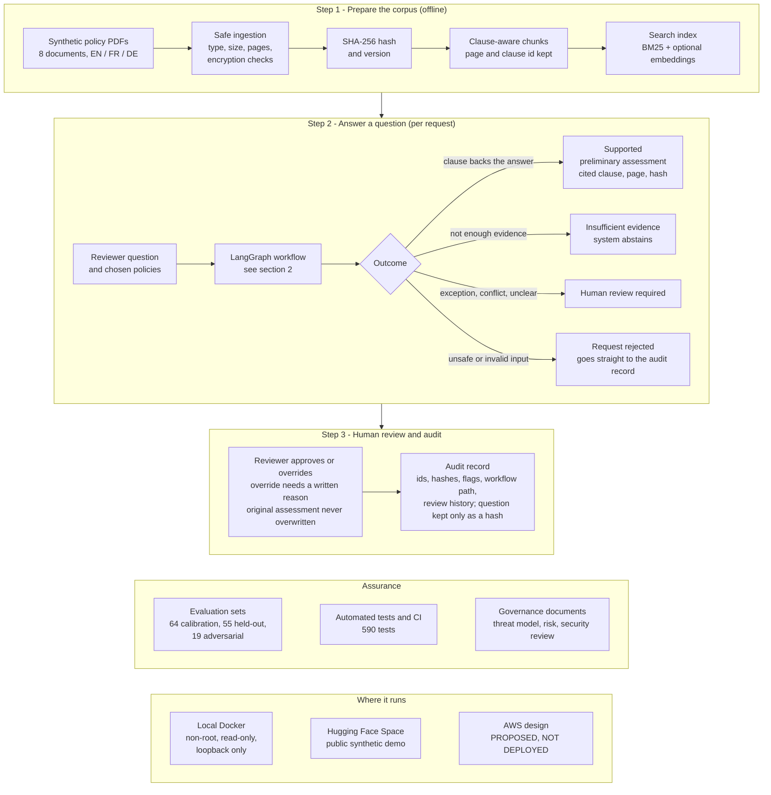

# Governed Claims Coverage Engine

**Author: Mohammed Imran Ali**

- **Live demo (synthetic data, no sign-in needed):** https://huggingface.co/spaces/EmranAIShaper/governed-claims-coverage-engine
- Direct app URL: https://emranaishaper-governed-claims-coverage-engine.hf.space
- Security and governance documents: https://huggingface.co/datasets/EmranAIShaper/governed-claims-security-docs
- Video walkthrough (6 min): https://youtu.be/8l1NU6hqR10

An evidence-grounded decision-support prototype that helps a human reviewer check what an insurance policy says about a question: hybrid retrieval, a deterministic rule engine (not an LLM), validated citations, abstention when evidence is thin, human review with an audit trail, and a LangGraph workflow. It runs on synthetic policies only.

**Try it:** open the demo, tab 1 *Assess* (pick the home policy and a guided example, then *Assess*), tab 2 *Human review (demonstration)*, tab 3 *Audit*. Review and audit entries from all visitors share one in-memory demo state and reset when the Space restarts. Please do not enter real personal or claim data.

Prototype status: synthetic data, no authentication, not production-ready, not certified. The detailed engineering notes below were written during development.


## How it works



The per-request LangGraph workflow, with every conditional route, is in [docs/PROCESS_OVERVIEW.md](docs/PROCESS_OVERVIEW.md).

---

# Governed Claims Coverage Engine (prototype - Milestone 2)

Decision-support prototype for preliminary insurance coverage interpretation. **Not** an automated
claims adjudicator, **not** production-ready, **synthetic data only**.

## What exists in Milestone 1
- `ingestion.py` - secure PDF ingestion: extension/magic/size/page-count checks, encrypted and malformed
  rejection, per-page text with 1-based page numbers, empty-page flagging, SHA-256 + doc id + version.
- `bm25.py` - in-house Okapi BM25 (documented formula, deterministic ties). Swappable later.
- `embeddings.py` - OPTIONAL semantic mode; lazy import; `local_files_only=True`, never downloads.
- `schemas.py` - Pydantic models: EvidenceRef, Assessment, HumanReview, AuditRecord, DocumentRecord.
- `synthetic.py` - generates two fictional policy PDFs (home, travel), byte-reproducible.

## Run
```
pip install -r requirements-dev.txt
set PYTHONPATH=src            (PowerShell: $env:PYTHONPATH="src")
python -m claims_engine.synthetic data/policies
python -m pytest -q
ruff check . ; mypy src
```
Lexical-only mode needs no network and no model. For semantic mode see `requirements-embeddings.txt`
(use a separate venv; fetch the model yourself, then pass its local folder to `load_embedder`).

## Dependency notes (verified 2026-10-27)
Core: pydantic 2.12.5, PyMuPDF 1.27.2.3, numpy 2.4.6, langgraph 1.2.10. Dev: pytest 7.4.0, ruff 0.17.1, mypy 1.8.0, reportlab 5.0.0.
Semantic (venv only, `requirements-embeddings.txt`; full lock: `requirements-lock-venv.txt`): sentence-transformers 6.2.0, torch 2.14.1 (CPU),
transformers 5.21.0. Model: `paraphrase-multilingual-MiniLM-L12-v2` (Apache-2.0, ~449 MB) pinned to a Hugging Face revision and verified by SHA-256.
The shared Anaconda environment is never modified.
## Milestone 2 additions
- `chunking.py` page+clause-aware chunks (one page each, clause ids, section context, neighbour links).
- `retrieval.py` BM25 / vector / hybrid (RRF); lexical-only fallback is explicit (`degraded`, `notice`).
- `eval_retrieval.py` + `eval/retrieval_cases.jsonl` -> `eval/RETRIEVAL_REPORT.md`.
- Semantic mode (isolated venv): 
  ```
  python -m venv .venv ; .venv\Scripts\pip install -r requirements-dev.txt -r requirements-embeddings.txt
  .venv\Scripts\python -m claims_engine.fetch_model     # deliberate, pinned, checksum-verified download
  .venv\Scripts\python -m claims_engine.eval_retrieval  # add --no-semantic for lexical-only
  ```
  Without the package or model the app runs lexical-only and says semantic retrieval is disabled; it never downloads.

## Milestone 3 additions
Workflow (`workflow.py`, diagram in `docs/WORKFLOW.mmd`), deterministic assessor (`assessor.py`), citation validator (`citations.py`),
injection tripwire (`guardrails.py`), support/abstention gate (`support.py` + `calibration/`), review + audit (`review.py`).
```python
from claims_engine.eval_common import load_docs
from claims_engine.workflow import Workflow, WorkflowContext
docs = load_docs("policies")                        # synthetic PDFs
wf = Workflow(WorkflowContext.from_documents(docs))  # lexical-only unless an embedder is passed
r = wf.run({"query": "burst pipes sudden accidental escape water", "doc_ids": [docs[0].doc_id]})
print(r.kind, r.assessment.status, r.review_priority)   # a PRELIMINARY interpretation for a human reviewer
```
Evaluate (venv): `python -m claims_engine.eval_variants`, `python -m claims_engine.calibrate`, `python -m claims_engine.eval_workflow`
(add `--no-semantic` for lexical-only). Reports land in `eval/m3/` and `calibration/`. Read `eval/PREREGISTRATION.md`,
`eval/m3/M3_FINDINGS.md` and `SECURITY_LIMITATIONS.md` before quoting any number. Synthetic data only; not production-ready.

## Milestone 4: run the demo
```
.venv\Scripts\pip install -r requirements-demo.txt          # project venv only
.venv\Scripts\python -m claims_engine.app                    # http://127.0.0.1:7860 (add --semantic if models/ is fetched)
```
Offline, local-only, synthetic data, no uploads. Walkthrough with screenshots: `docs/DEMO_WALKTHROUGH.md`.
Read the limitations banner in the app and `SECURITY_LIMITATIONS.md`: not production-ready, not legally certified, reviews are demonstrations.

## Milestone 5: governance, container, CI (read the status first)
* Governance documents: `governance/` (start at `governance/README.md`). Legal references record how each statement was verified; nothing claims compliance.
* **Container (lexical-only runtime image and semantic image built and smoke-tested locally on 2026-10-27; see `docs/RELEASE_GATES.md`; both images scanned with Trivy on 2026-10-28; see `governance/CONTAINER_SCAN_2026-10-28.md`):** `docker build --target runtime -t claims-demo .` then
  `docker run --rm -p 127.0.0.1:7860:7860 --read-only --tmpfs /tmp --cap-drop ALL --security-opt no-new-privileges claims-demo`, or `docker compose up demo`.
  Lexical-only by default; semantic mode is an optional target that mounts a model you fetched yourself (built and run locally once; not covered by CI; torch is not hash-pinned). No model is downloaded at build or start.
* CI: `.github/workflows/ci.yml` (has run on GitHub Actions: lint/types/tests, audit gate and lexical docker smoke test passed on `main`; see `docs/RELEASE_GATES.md`).
* Dependency audit: `pip-audit` + `scripts/check_audit_allowlist.py` (see `governance/DEPENDENCY_REPORT.md`, `governance/PILLOW_ADVISORY_REVIEW.md`). The app has **no authentication** and must not be exposed to untrusted networks.