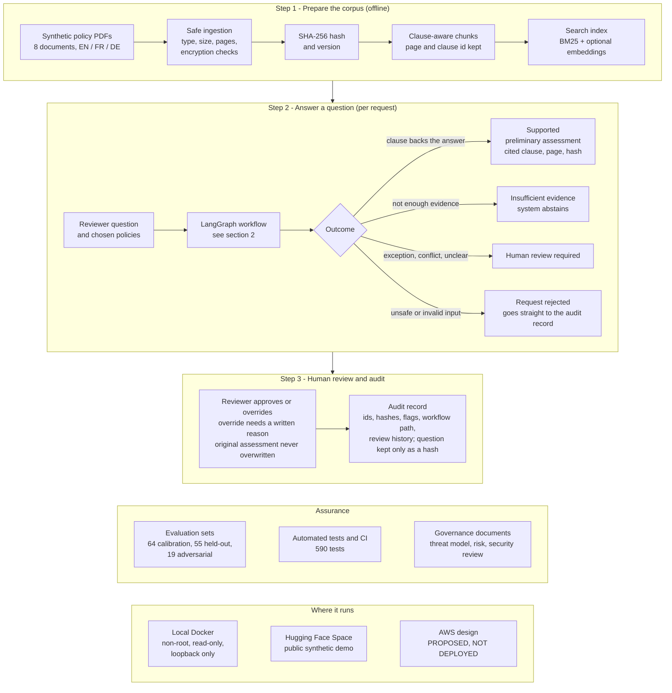
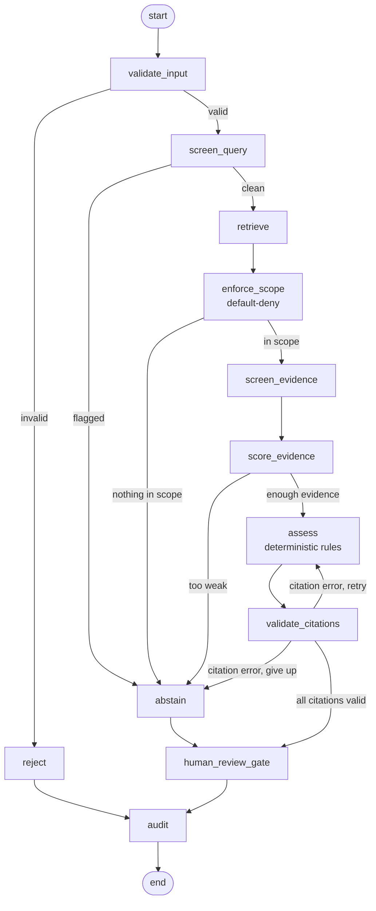

# Process overview

How the Governed Claims Coverage Engine works from policy documents to an audited, human-reviewed answer. All data is synthetic. The assessor is a deterministic rule engine, not an LLM.

## 1. End to end

## 2. The per-request workflow (LangGraph)

Solid arrows always happen; labelled arrows are the conditional routes in `src/claims_engine/workflow.py`. Every path ends at the audit record.

## 3. What a citation must match

Before any answer is shown, each citation is validated against the passage retrieved for that request: chunk id, document id, SHA-256, version, page, clause, verbatim quote and scope. A valid citation proves the quote is real, not that the clause supports the verdict.

## 4. Scope and limits

Synthetic data only. The demo has no authentication, so it must not be used with real data. The AWS design is a proposal; nothing is deployed on AWS. See `governance/` and `SECURITY_LIMITATIONS.md` for the full list of limits.
